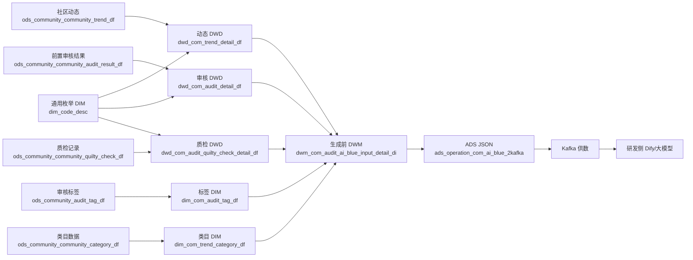
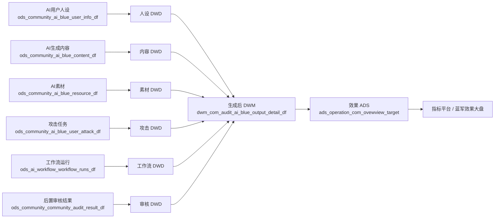

# AI 蓝军项目两条链路与关键 ID

> 阶段：第二阶段项目技术复盘。  
> 真实性边界：用户确认核心 DWD 6 张、DWM 2 张、ADS 2 张由本人独立开发、上线并稳定调度，且亲自完成验证和下游验收；本文对 SQL 细节的描述来自当前仓库截图整理版和本地复现版。两者存在差异时，不把本地发现的问题虚构为生产事故。  
> 数据量边界：本文出现的 100/200 条均为 `pt='2026-07-11'` 本地造数，不是生产数据量。

## 1. 项目为什么有两条链路

AI 蓝军项目不是一张从源表直接聚合到大盘的普通报表链路，而是两个生命周期不同的闭环：

1. **生成前链路**：从真实社区内容和审核上下文中筛选、清洗模型输入，为研发侧的 Dify/大模型生成提供素材。
2. **生成后链路**：回收 AI 生成内容、人设、素材、攻击任务、工作流运行和审核结果，评价黑样本是否被拦截、白样本是否被误杀。

两条链路不能强行合成一张宽表：前者以原始社区动态 `trend_id` 为主线，后者以蓝军素材 `resource_id` 及投放后的内容/任务为主线，粒度和发生时间均不同。

## 2. 生成前链路：社区内容到 Kafka/Dify

### 2.1 链路图



### 2.2 逐段解释

1. ODS 保留社区动态、审核、质检、标签和类目源数据。
2. DWD 将 ID 类型、时间、字段名称和枚举口径标准化；DIM 提供中文标签和三级类目名称。
3. 生成前 DWM 以 `dwd_com_trend_detail_df.trend_id` 为主线，补充作者互动、类目、机审结果、人审结果、标签和质检信息。
4. ADS 将一条内容及其上下文转换为约定 JSON。
5. 用户确认本人负责将数据推送到 Kafka 给研发；Dify 工作流节点、Prompt 和模型配置不是本人职责。

### 2.3 生成前目标粒度

目标是一条“当日社区动态及其可用于生成的审核上下文”。主键候选是：

```text
pt + trend_id
```

当前 SQL 的两个过滤条件是 DWD 分区等于业务日期、动态发布日期也等于业务日期。审核、标签或质检如果一对多，必须先聚合或选定唯一记录，否则 `trend_id` 不再唯一。

### 2.4 当前 SQL 中影响链路的关键点

- `trend_id = audit.biz_id`：原始动态与前置审核结果的核心关联。
- 标签需先按审核业务 ID 聚合，再回到动态粒度。
- 当前截图整理版对人审标签使用 INNER JOIN，会过滤无可映射人审标签的动态。
- 当前截图整理版存在 `level3_category_code = quality.biz_id` 的可疑关联；正常语义更可能是动态/审核业务 ID 与质检 `biz_id` 或审核 `audit_id` 关联，需以后续生产口径为准。
- JSON 需要正确转义正文中的引号、换行和反斜杠；不能靠字符串拼接假定结果一定合法。

## 3. 生成后链路：蓝军生成到效果指标

### 3.1 链路图



### 3.2 业务顺序

```text
蓝军素材/参考内容
→ 大模型生成内容和人设
→ 内容与素材入库
→ 创建攻击任务并由实际蓝军账号投放
→ 投放后产生新的社区 trend_id
→ 审核系统以该 trend_id 作为 biz_id 记录机审/人审结果
→ 数仓回收工作流、投放和审核结果
→ 形成生成后 DWM
→ 聚合黑拦截、黑漏过、白放过、白误杀等指标
```

### 3.3 生成后目标粒度

当前宽表以素材 `resource_id` 为主表，但真实唯一粒度必须结合业务选择：

- 素材级：一行一个 `resource_id`，其他多值关系需预聚合。
- 攻击任务级：一行一个 `resource_id + attack_task_id`。
- 审核级：一行一个 `resource_id + attack_task_id + audit_id`。

当前截图 SQL 未在 JOIN 前显式去重。若一个素材对应多条内容、多个攻击任务、多个审核结果，多对多相乘会放大 ADS 的 `COUNT` 和 `SUM`。生产版必须通过唯一键约束、取最新、预聚合或指标端去重治理；技术复盘时需要按本人真实实现说明。

## 4. 关键 ID 字典

| ID | 来源及业务含义 | 主要出现位置 | 关联用途 | 风险 |
| --- | --- | --- | --- | --- |
| 原始 `trend_id` | 生成前的真实社区动态 ID | trend ODS/DWD、DWM input | `trend_id = 前置审核.biz_id`，构造模型输入 | 与投放后 `trend_id` 不是同一批 ID |
| 投放后 `trend_id` | AI 内容投放后形成的新社区内容 ID | AI content ODS/DWD | `trend_id = 后置审核.biz_id`，回收测评结果 | 不得复用原始动态 ID |
| `biz_id` | 审核/质检/工作流中的业务对象 ID，语义随系统而变 | audit、quality、workflow DWD | 审核表中通常承接被审核内容的 `trend_id` | 不能只凭字段同名就跨系统关联 |
| `resource_id` | 蓝军素材库素材 ID | resource、content、attack | 连接素材、生成内容和攻击任务，是输出链路主桥 | 一条素材可能多内容、多任务 |
| `user_id` | 实际执行投放的蓝军账号 ID | user_attack | 说明谁执行攻击任务 | 不等于 AI 人设用户 ID |
| `ai_blue_user_id` | 生成内容采用的 AI 人设/蓝军用户 ID | content、user_info | 连接生成内容和人设 | 与实际投放账号需分开命名 |
| `request_id` | 内容或人设生成请求 ID | content/user_info ODS | 追踪一次生成请求 | 需确认是否全局唯一及失败重试行为 |
| 工作流运行 `id` / `workflow_runs_id` | Dify 一次运行的 ID | workflow ODS/DWD | `ai_blue_content_request_id = workflow_runs_id` | 重试可能产生多个运行 ID |
| `workflow_id` | 工作流模板/定义 ID | workflow runs | 区分运行属于哪个工作流 | 不是单次运行主键 |
| `attack_task_id` | 一次攻击任务 ID | user_attack | 连接素材与投放任务，适合作为任务级去重键 | 同一素材可能多次投放 |
| `audit_id` | 一条审核记录 ID | audit/quality | 连接审核和质检，或区分多次审核 | 同一 `biz_id` 可能多条审核记录 |

## 5. 前置与后置审核为什么不能复用同一批 `biz_id`

生成前审核评价的是“真实社区原始动态”，生成后审核评价的是“AI 生成并投放后的新动态”。两者虽然都进入同一类审核表，但业务对象不同：

```text
原始 trend_id ──> 前置 audit.biz_id
投放后 trend_id ──> 后置 audit.biz_id
```

如果造数或生产链路复用同一批 `biz_id`：

1. 一条内容会同时匹配前置和后置审核，无法区分审核阶段。
2. DWM JOIN 可能形成一对多或多对多，导致整批指标膨胀。
3. 前置标签可能被误当作蓝军投放后的审核结果。
4. 黑拦截、黑漏过、白放过和白误杀的分子会被污染。

更稳妥的设计是源头保证两批内容 ID 不重叠，并在审核事实中增加或派生 `audit_stage`：

```text
pre  = 生成前参考内容审核
post = AI内容投放后审核
```

`audit_stage` 不能替代正确的业务 ID，但能增强口径可读性、分区过滤和质量校验。

## 6. 两条链路的验收检查

### 生成前

- 原始动态数、前置审核匹配数、无审核数、无标签数分别对账。
- 检查 `trend_id` 唯一性以及 JOIN 前后放大倍数。
- 检查类目、标签和枚举的匹配率。
- 对 JSON 做结构解析而非肉眼抽样，覆盖引号、换行、反斜杠和 NULL。
- Kafka 侧核对发送量、消费量、重复量、失败重试和业务主键。

### 生成后

- 素材到内容、人设、任务、工作流和审核的关联率分别统计。
- 检查 `resource_id`、`attack_task_id`、`audit_id` 的基数关系。
- 用四条最小样本验证黑拦截、黑漏过、白放过、白误杀互斥且不遗漏。
- 前置与后置 `biz_id` 交集应为 0；如果不为0，应阻断或告警。
- ADS 分子不得大于分母，同一任务不可因多审核记录被重复计数。

## 7. 当前面试可用职责边界

> 我独立完成了核心 DWD 6 张、生成前和生成后两张 DWM、两张 ADS 的开发、上线和验收。生成前，我把真实社区动态和前置审核上下文加工成 JSON，并负责推送 Kafka 给研发；Dify 工作流配置不是我负责。生成后，我通过素材、内容、人设、攻击任务、工作流运行和投放后审核结果形成效果宽表，支撑指标平台。两段审核使用不同批次的内容 ID，不能复用同一批 `biz_id`。

该表述中的生产经历来自用户事实确认；收益精确数字因统计周期、口径和来源遗忘，仍不在本阶段使用。
