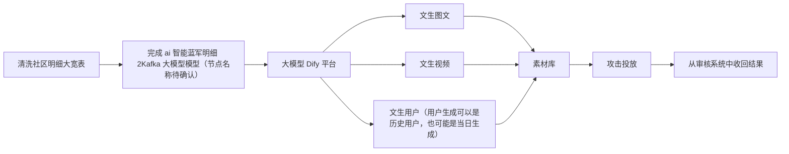
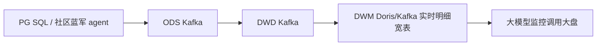
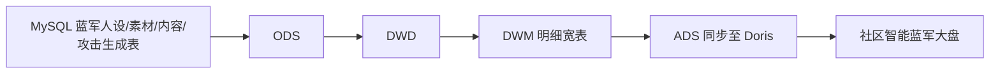

# 大模型社区智能蓝军 PRD 全文整理

## 1. 来源截图

- `大模型社区智能蓝军PRD/1.png`
- `大模型社区智能蓝军PRD/2.png`
- `大模型社区智能蓝军PRD/3.png`
- `大模型社区智能蓝军PRD/4.png`
- `大模型社区智能蓝军PRD/5.png`
- `大模型社区智能蓝军PRD/6.png`
- `大模型社区智能蓝军PRD/7.png`
- `大模型社区智能蓝军PRD/8.png`
- `大模型社区智能蓝军PRD/9.png`
- `大模型社区智能蓝军PRD/10.png`

## 2. 项目背景

### 2.1 背景说明

蓝军解释：风控蓝军测评服务，模拟黑产攻击方式，对业务发起攻击测评，检验业务安全防护能力。代替传统手动测评方式，将测评流程预置在平台中，实现系统自动化攻击测评，说白了就是校验风控机审、人审的能力，确保机审、人审能够对系统生成的问题内容准确拦截。

红军解释：红军也是模拟内容产生，和蓝军是反向的，即内容是符合平台要求的，用于校验风控机审、人审的能力，确保机审、人审能够对系统生成的内容别误伤/误判。

### 2.2 蓝军业务主要痛点

1. 日常攻防运营效率还有较大提升空间：经过一系列蓝军产品功能建设后，虽然已经具备一定有效产出，但现阶段黑白样本收集大部分还是依靠人工运营。可通过系统化的产品能力以及借助更高效的工具（站外内容爬取、AIGC 等）进一步提升运营效率，释放运营人力投入。在蓝军运营工作流程中，人力投入较大的主要是样本收集阶段，占运营人力的 50%。
2. 用户仿真度不够：攻击内容较生硬，与真实、常见的社区调性差异较大；模拟用户没有“人设”，不够真实；产品功能上，用户账号一用即废，无养号、账号持续运营能力，导致蓝军的隐蔽性受到质疑。

## 3. 项目价值

### 3.1 定性目标

- 利用工作流产生的数据，缩短蓝军寻找样本的时间。
- 获取 y shopping，丰满蓝军人设，达到仿真效果。
- 组合蓝军人设与攻击技能，缩短蓝军组装样本时间。

### 3.2 定量目标

- 攻防效率：降低运营运行投入 30%。
- 素材收集效率：每周新增有效素材（黑、白样本），白样本提高 50%，黑样本提高 20%。
- 攻防效果：黑样本成功率提升 10%，白样本攻击成功率提升 5%，机审成功率降低至 30%+（原 70%+）。

## 4. 业务与素材生产链路

来源截图：`大模型社区智能蓝军PRD/3.png`

截图表达的主链路如下：



该链路体现的目标是：基于社区明细数据和大模型/Dify 平台生成更拟真的蓝军素材、人设和攻击内容，进入素材库后进行攻击投放，并从审核系统回收攻防结果。

## 5. 数据推数模板

来源截图：`大模型社区智能蓝军PRD/4.png`

```json
{
  "trendId": "001",
  "url": "xxxxx",
  "data": {
    "contentTitle": "XXX",
    "content": "XXX",
    "publishUserId": "XXX",
    "publishUserName": "XXX",
    "publishUserFans": "XXX",
    "favoriteCnt": "20",
    "replyCnt": "20",
    "shareCnt": "30",
    "level1CategoryName": "穿搭",
    "level2CategoryName": "配饰",
    "level3CategoryName": "帽子",
    "tagNameList": "穿搭,adidas,ootd",
    "selectedTypeName": "非精选",
    "machineTagResultName": "通过",
    "tagResultName": "隐藏",
    "TagNameList": "色情低俗",
    "machineTagNameList": "",
    "checkResultName": "隐藏"
  }
}
```

字段含义可初步理解为：内容基础信息、发布用户信息、互动计数、内容类目、标签、机审结果、人审/标签结果和最终审核结果。

## 6. 数据指标需求

来源截图：`大模型社区智能蓝军PRD/5.png`、`大模型社区智能蓝军PRD/6.png`、`大模型社区智能蓝军PRD/7.png`、`大模型社区智能蓝军PRD/8.png`

PRD 中的指标需求主要面向“深蓝系统-首页”，包含核心业务指标和智能蓝军相关指标。完整合并版见 `数据指标需求整理.md`。

核心指标包括：

- 首页 banner 位展示红蓝攻防状态。
- 攻击时间筛选，支持日、周、月。
- 累计攻击次数、样本库量级。
- 样本攻击次数、一本多投成功率、黑样本攻击成功率、白样本攻击成功率。
- 防御质量分、难度等级分布、一级标签分布。
- 机审直接处置率、机审直接处置错误率。
- 普通素材 VS 智能蓝军素材生产量、智能蓝军素材可用率。
- 普通攻击 VS 智能蓝军攻击次数。
- 仿真覆盖维度、标签覆盖范围、人设攻击次数。

## 7. 数据链路与数仓分层

来源截图：`大模型社区智能蓝军PRD/9.png`、`大模型社区智能蓝军PRD/10.png`

PRD 中同时出现了实时链路和离线链路。根据项目要求，本次整理重点落在离线数仓链路，实时链路只作为背景说明。

### 7.1 实时链路背景



实时链路主要通过 Flink CDC / Flink SQL 进入 Kafka/Doris，形成实时明细宽表，并与 ADS 指标口径保持一致。

### 7.2 离线链路重点



离线链路用于把蓝军人设、素材、内容、攻击，以及审核系统、大模型工作流等数据拼接成可复用、可查询、可支撑看板分析的明细宽表和指标结果。

### 7.3 PRD 中出现的数仓表关系

| 层级 | 表/节点 | 中文含义 |
| --- | --- | --- |
| DWM | `dwm_com_audit_ai_blue_detail_di` | ai 智能蓝军明细大宽表，前置链路使用 |
| ADS | `ads_operation_com_ai_blue_2kafka` | ai 蓝军数据推送 Kafka |
| ODS | `ods_community_ai_blue_user_info_df` | ai 蓝军运营账号用户人设表 |
| ODS | `ods_community_ai_blue_content_df` | ai 社区蓝军内容表 |
| ODS | `ods_community_ai_blue_resource_df` | ai 蓝军社区蓝军素材表 |
| ODS | `ods_community_ai_blue_user_attack_df` | ai 社区蓝军用户攻击表 |
| DWD | `dwd_ai_workflow_workflow_detail_df` | 大模型工作流明细 |
| DWD | `dwd_com_audit_detail_df` | 社区域-审核域-审核结果表 |
| DWD | `dwd_com_audit_ai_blue_user_info_df` | 社区域-审核域-ai 蓝军运营账号用户人设表 |
| DWD | `dwd_com_audit_ai_blue_content_df` | 社区域-审核域-ai 社区蓝军内容表 |
| DWD | `dwd_com_audit_ai_blue_resource_df` | 社区域-审核域-ai 蓝军社区蓝军素材表 |
| DWD | `dwd_com_audit_ai_blue_user_attack_df` | 社区域-审核域-ai 社区蓝军用户攻击表 |
| DWM | `dwm_com_audit_ai_blue_output_detail_df` | 社区域-审核域-ai 智能蓝军明细大宽表 |
| ADS | `ads_operation_com_ai_blue_overview_target` | ai 蓝军社区大盘 |
| 看板 | 社区智能蓝军大盘 | 面向业务展示的看板 |

## 8. 整体复盘口径

该项目围绕“大模型社区智能蓝军”展开，核心目标是通过系统化、大模型化、数据化的方式提升蓝军攻防运营效率，解决人工收集黑白样本效率低、用户和内容仿真度不足、攻防效果缺少统一评估口径等问题。

从数据侧看，PRD 的重点不是单个页面，而是一条完整的离线数据链路：从蓝军人设、素材、内容、攻击等 ODS 明细数据入仓，经 DWD 清洗和审核域打通，在 DWM 拼接成智能蓝军明细宽表，再在 ADS 形成可供 Doris/看板使用的指标结果。

从业务侧看，PRD 关注的指标主要覆盖攻防效率、样本库建设、黑白样本攻击效果、机审/人审识别效果、标签与难度覆盖、智能蓝军素材生产和攻击投放效果。
