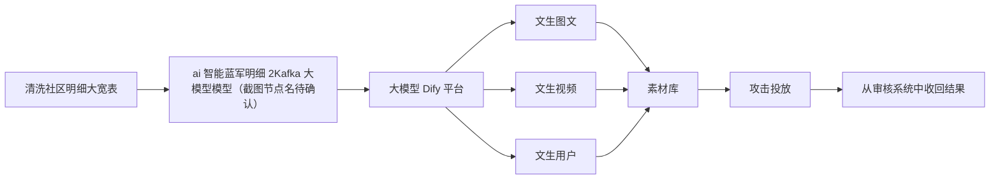
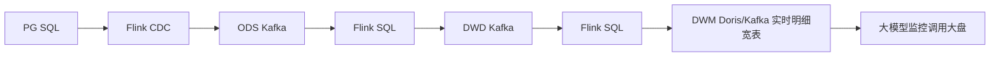
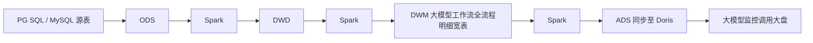
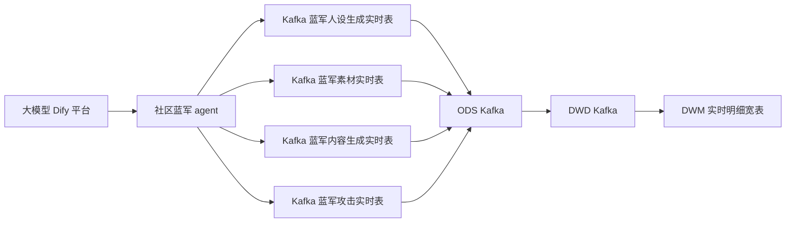
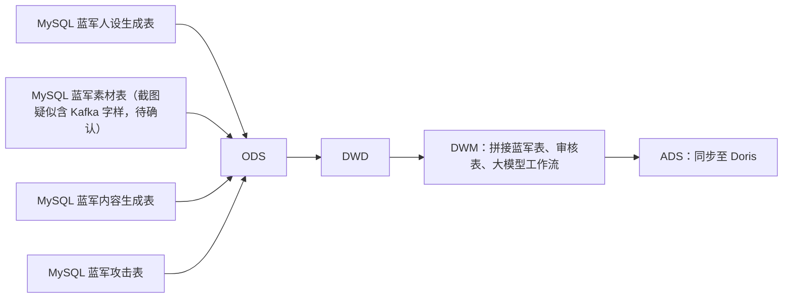
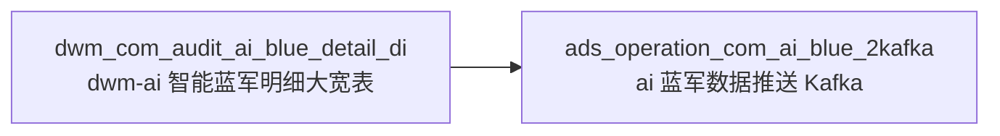
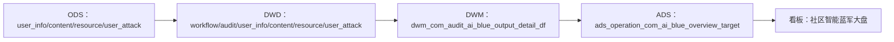

# 数据链路图解读

来源截图：

- `大模型社区智能蓝军PRD/3.png`
- `大模型社区智能蓝军PRD/9.png`
- `大模型社区智能蓝军PRD/10.png`

## 1. 素材生产与攻击投放链路

截图 3 描述的是从社区明细数据到大模型生成，再到素材库、攻击投放和审核系统回收结果的业务链路。

文生用户节点备注：截图中说明“用户生成可以是用历史用户，也有可能是当日生成”。

## 2. 大模型底座链路

截图 9 展示了大模型底座下的实时链路和离线链路。

### 2.1 实时链路

截图说明：DWM 节点用于形成实时明细宽表，完成物化视图建设，并书写指标计算逻辑，和 ADS 口径一致。

### 2.2 离线链路

截图说明：离线链路在 DWM 层开发大模型工作流全流程明细宽表，用于提升复用和查找；ADS 层同步至 Doris，一份用于 OLAP 快速加载。

## 3. 社区蓝军 agent 链路

截图 9 中部展示了“社区蓝军 agent”链路。

## 4. 离线蓝军源表链路

截图 9 下部展示了离线源表进入数仓的链路。

## 5. 数仓分层看板链路

截图 10 展示了“前置”和“模型处理”两段。

### 5.1 前置链路

### 5.2 模型处理链路

## 6. 截图中出现的主要表

| 层级 | 表名 | 截图中文说明 |
| --- | --- | --- |
| DWM | `dwm_com_audit_ai_blue_detail_di` | dwm-ai 智能蓝军明细大宽表 |
| ADS | `ads_operation_com_ai_blue_2kafka` | ai 蓝军数据推送 Kafka |
| ODS | `ods_community_ai_blue_user_info_df` | ai 蓝军运营账号用户人设表 |
| ODS | `ods_community_ai_blue_content_df` | ai 社区蓝军内容表 |
| ODS | `ods_community_ai_blue_resource_df` | ai 蓝军社区蓝军素材表 |
| ODS | `ods_community_ai_blue_user_attack_df` | ai 社区蓝军用户攻击表 |
| DWD | `dwd_ai_workflow_workflow_detail_df` | 大模型工作流 |
| DWD | `dwd_com_audit_detail_df` | dwd-社区域-审核域-审核结果表 |
| DWD | `dwd_com_audit_ai_blue_user_info_df` | dwd-社区域-审核域-ai 蓝军运营账号用户人设表 |
| DWD | `dwd_com_audit_ai_blue_content_df` | dwd-社区域-审核域-ai 社区蓝军内容表 |
| DWD | `dwd_com_audit_ai_blue_resource_df` | dwd-社区域-审核域-ai 蓝军社区蓝军素材表 |
| DWD | `dwd_com_audit_ai_blue_user_attack_df` | dwd-社区域-审核域-ai 社区蓝军用户攻击表 |
| DWM | `dwm_com_audit_ai_blue_output_detail_df` | dwm+社区域-审核域-ai 智能蓝军明细大宽表 |
| ADS | `ads_operation_com_ai_blue_overview_target` | ai 蓝军社区大盘 |
| 看板 | 社区智能蓝军大盘 | 社区智能蓝军看板展示 |

## 7. 整理结论

PRD 中的链路可以理解为：业务端通过 Dify/大模型生产蓝军内容、人设和素材，投放后回收审核结果；数据端通过 ODS、DWD、DWM、ADS 分层沉淀蓝军运营、审核、大模型工作流等数据，最终支撑社区智能蓝军大盘。

实时链路在 PRD 中作为大模型底座和监控背景出现；离线链路是当前数仓表整理的主线。
