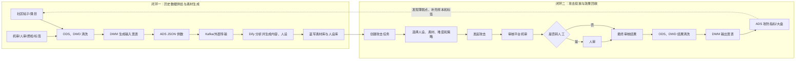
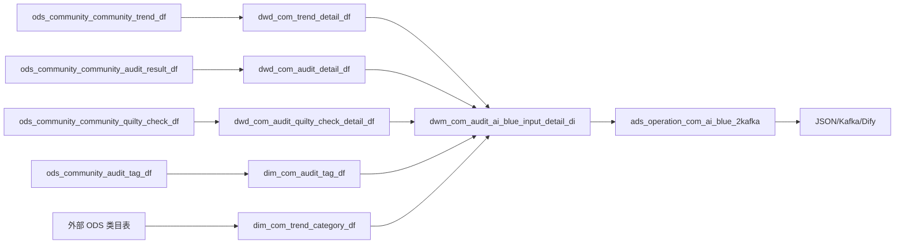
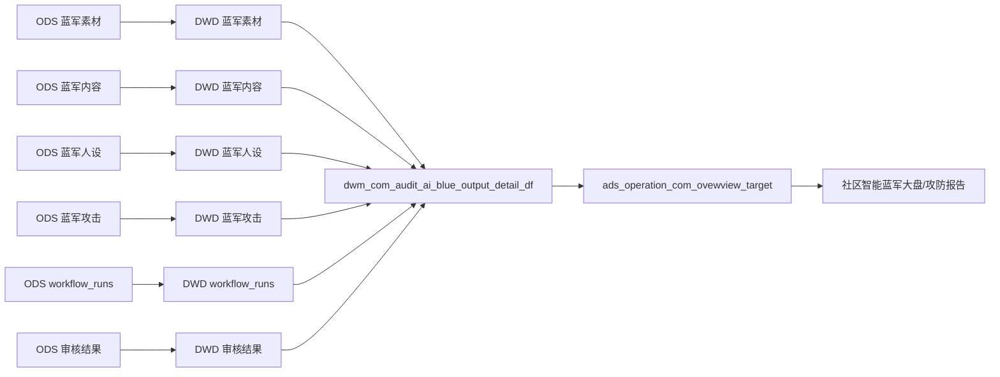

# 大模型社区智能蓝军项目完整流程梳理

## 1. 文档定位

本文基于两部分资料交叉整理：

- 用户补充的完整 PRD 截图，共 27 张；其中第 19-23 张是“5.1 整体流程”长泳道图的连续分段，第 22、23 张内容重复。
- `project_extracted_docs/01_PRD` 中已有的背景、指标和链路文档，以及 `project_extracted_docs/02_数仓整理` 中现存的 ODS、DWD、DWM、DIM、ADS 表和 SQL。

本文的目标不是复述每张截图，而是回答三个问题：项目解决什么问题、业务从素材生成到结果回收是怎样运转的、离线数仓在其中承担什么职责。

当前项目职责边界按现有资料理解为：**重点实现离线数仓链路；Dify、大模型生成、蓝军前端和审核策略本身作为上下游业务背景理解，不视为当前数仓实现内容。**

## 2. 一句话理解项目

项目用历史社区内容、类目、机审、人审和质检信息作为参考数据，通过 Dify 生成更真实的黑白样本与用户人设，在蓝军平台创建并自动投放攻击任务，经过审核平台的机审和人审后回收结果，再由离线数仓统计漏过、拦截、误伤、放过和生成效率等指标，形成下一轮素材生产和风控优化依据。

## 3. 核心业务概念

| 概念 | 在本项目中的含义 | 期望审核结果 |
| --- | --- | --- |
| 蓝军/黑样本 | 模拟违规、黑产或风险内容，测试审核能否识别并拦截 | 应被机审或人审拦截 |
| 红军/白样本 | 模拟符合平台要求的正常内容，测试审核是否误伤 | 应被正常放过 |
| 攻击任务 | 将选定的人设、素材、样本属性、难度和攻击策略组合后进行投放 | 获得一次完整审核结果 |
| 机审 | 违禁词、规则引擎、自有风控模型、外部模型等自动审核 | 产生机审标签和处置结果，并决定是否转人工 |
| 人审 | 初审、双审、复审、打标，以及抽样质检、召回和回查 | 产生最终处置结果、标签和审核人信息 |
| 一本多投/二次投放 | 原始需求文档中的历史概念 | 后续已确认一份 `resource_id` 素材对应一次投放；当前 ADS 不统计同一素材二次投放。不同攻击场景生成的不同 `resource_id` 是不同素材，不是复投 |

需要特别区分“平台防守是否正确”和“测试是否发现问题”：

- 黑样本被放过，是审核漏过；从防守角度是失败，但从蓝军找到漏洞的角度常被称为“攻击成功”。
- 白样本被拒绝，是审核误伤；从防守角度也是错误，但 PRD 的“白样本攻击成功率”公式使用了人审非通过数，本质是在统计发现误伤问题的比例。
- ADS SQL 中的字段名同时使用了 `success` 和 `fail`。讲解项目时应优先说“黑样本拦截/漏过、白样本放过/误伤”，避免只说“成功率”造成歧义。

## 4. 项目背景与目标

### 4.1 原有痛点

1. 黑白样本收集大量依赖人工，样本收集约占蓝军运营人力的 50%。
2. 攻击内容较生硬，与真实社区内容的调性差距较大。
3. 模拟用户没有稳定人设，账号一用即废，缺少养号和持续运营能力，攻击隐蔽性不足。
4. 素材生产、任务投放、审核回收和效果分析缺少一体化链路。

### 4.2 目标

- 用历史社区内容和审核数据缩短样本寻找时间。
- 用内容生成、用户人设和账号仿真提高攻击真实性。
- 将人设、攻击技能、样本属性和难度组合，缩短样本组装时间。
- 降低运营投入 30%。
- 每周新增白样本提高 50%、黑样本提高 20%。
- 黑样本攻击成功率提高 10%、白样本攻击成功率提高 5%，并通过更强样本暴露审核问题。

## 5. 系统角色与职责边界

| 系统/团队 | 主要职责 | 与离线数仓的关系 |
| --- | --- | --- |
| 社区业务数据源 | 提供历史帖子、用户、互动、类目和 URL 等内容数据 | 进入社区趋势 ODS/DWD 表，作为生成参考数据 |
| 审核系统/审核平台 | 执行机审、人审、处置、打标和质检，返回最终审核结果 | 审核结果、标签和质检数据进入 ODS/DWD，并参与供数和结果复盘 |
| 离线数仓 | 清洗内容与审核数据、构造生成输入、拼接生成与攻击结果、计算指标 | 当前项目实现重点 |
| Dify/大模型平台 | 数据预处理、文本分析、Prompt 组装、文生文、文生图、用户介绍生成、校准出参 | 作为上下游业务背景；工作流执行信息进入数仓 |
| 蓝军系统 | 素材库、人设管理、任务创建、攻击方式配置、自动调度、投放、结果展示 | 产生人设、内容、素材和攻击任务的业务源表 |
| 运营人员 | 筛选素材、选人设、定样本属性与难度、必要时二次编辑、发起任务 | 操作结果沉淀到蓝军业务表 |
| 数据分析/风控策略 | 分析漏过、拦截和误伤，输出攻防报告与规则优化建议 | 消费 ADS 指标和明细数据 |

## 6. 完整业务架构：两个数据闭环

这两个闭环分别对应当前数仓中的两张 DWM 宽表：

- `dwm_com_audit_ai_blue_input_detail_di`：生成前的参考数据宽表，回答“给 Dify 什么数据”。
- `dwm_com_audit_ai_blue_output_detail_df`：生成、投放和审核后的结果宽表，回答“生成了什么、如何投放、审核结果怎样”。

PRD 图中的历史名称 `dwm_com_audit_ai_blue_detail_di`，按用户确认与当前 `dwm_com_audit_ai_blue_output_detail_df` 是同一张逻辑表。它不是 `dwm_com_audit_ai_blue_input_detail_di` 的别名；当前 `ads_operation_com_ai_blue_2kafka` SQL 实际读取的仍是 `input_detail_di`。

## 7. PRD 5.1 长泳道图的完整拼接

长图的泳道依次为“阶段、数据、大模型、蓝军系统、审核平台”，可还原为以下连续流程。

### 7.1 素材合成阶段

1. 从审核平台和 yshopping 社区业务数据中获取历史内容及审核信息。
2. 离线数仓清洗数据，形成蓝军 ADS 供数结果。
3. 将结果封装为 JSON，通过 Kafka 或外部传输任务送往 Dify。
4. Dify 结合知识库和 Prompt 加工内容，生成攻击素材或用户人设。
5. 生成结果进入蓝军系统素材库/人设库。
6. 前置素材准备完成后，由社区蓝军运营筛选待投放素材。

### 7.2 自动攻击准备阶段

1. 在蓝军系统中创建攻击任务。
2. 选择攻击角色：人设内容可由 AI 生成，实际投放账号由 yshopping 运营账号承载。
3. 选择样本难度。
4. 根据攻击场景组合黑样本和白样本，并生成或选取新素材。
5. 判断是否需要人工二次编辑：需要则编辑样本，不需要则直接进入下一步。
6. 将最终样本导入任务。
7. 配置攻击方式，可包含多投、均匀投放、自定义时间等策略，并由系统自动调度。

### 7.3 发起攻击与审核阶段

1. 蓝军系统按任务配置发起攻击。
2. 审核平台首先执行机审。
3. 机审给出标签和处置结果，并判断是否转人工。
4. 不转人工时，机审结果直接成为审核结果并执行风控策略。
5. 转人工时，进入初审、双审、复审、打标等人工审核流程。
6. 审核体系还可能通过线上质检抽样、召回抽样、敏感词或事件回查再次校验结果。
7. 机审或人审最终结果汇总为该次攻击的审核结果。

### 7.4 结果回收阶段

1. 审核结果数据回收到蓝军系统和离线数仓。
2. 蓝军系统进行攻击结果展示和任务状态管理。
3. 离线数仓将素材、人设、任务、Dify 工作流和审核结果拼接为输出宽表。
4. ADS 汇总素材量、攻击量、黑白样本、机审、人审、相似度和难度等指标；原 PRD 中复投指标与后续确认的一素材一次投放规则冲突，当前 ADS 已移除相关 4 个字段。
5. 数据分析和风控策略人员据此生成攻防报告，定位机审漏过、人审漏过和正常内容误伤问题，并推动规则、模型或审核策略优化。

## 8. Dify 工作流的业务理解

Dify 不是当前离线数仓的实现范围，但需要理解其输入、处理和输出，才能解释数仓为什么保留相关字段。

### 8.1 输入

PRD 截图展示的开始参数包括：

- 业务调用信息：`action`、`bizId`、`invokeTime`。
- 多模态内容：`text`、`audio`、`video`、`ocrText`。
- 系统上下文：文件、`user_id`、`app_id`、`workflow_id`、`workflow_run_id` 等。
- 数仓侧通过 JSON 提供帖子标题、正文、作者、粉丝数、互动数、三级类目、机审/人审标签、质检结果和 URL。

### 8.2 处理

截图体现的主要节点包括：

1. 数据预处理：清洗机器人特殊消息和冗余内容，输出 `content`、`current_content`、`message_id` 等。
2. 文本切分与高亮提取：按社区问答或帖子结构提取标题、描述、话题、正文、回答者标签等信息。
3. 变量与 Prompt 生成：结合人设主题、风险标签、类目、亮点、长度、篇数和元素要求组装提示词。
4. 文生文：生成符合目标社区调性的帖子正文。
5. 文生图：根据文本和参数调用图像生成能力，形成配套图片。
6. 文生用户介绍：生成昵称、签名/简介和用户人设。
7. 辅助信息抽取：部分流程会识别用户 ID、手机号、设备号等结构化信息。
8. 校准与出参：统一返回 `action`、`response_code`、`response_time`、`bizId`、`data`、`remark` 等字段。

### 8.3 数仓需要保留的 Dify 证据

`dwd_ai_workflow_workflow_runs_detail_df` 保存工作流运行 ID、应用 ID、工作流 ID、输入、输出、状态、耗时、Token、步数、异常数和业务 ID。它的用途不是实现模型，而是把一次生成任务与素材、内容和业务请求关联起来，支持生成效果、耗时和异常追踪。

## 9. 离线数仓完整链路

### 9.1 生成前供数链路

这条链路完成四类加工：

- 清洗历史社区内容及作者、互动、三级类目、精选状态和 URL。
- 将审核处置码映射为机审、人审结果名称。
- 将逗号分隔的机审、人审标签拆分后关联标签维表，再聚合成标签名称列表。
- 将一条帖子及其审核上下文封装为 Dify 可消费的 JSON。

当前 SQL 中，人审标签子查询使用内连接，意味着只有能关联到人审标签的内容才会进入最终输入结果；这不是单纯“把所有社区帖子发给模型”。

`ads_operation_com_ai_blue_2kafka` 的资料只提供 DDL 和独立 `SELECT`，没有 `INSERT OVERWRITE`。因此 SQL 能确认的是 JSON 生成格式；真正写 Kafka 的调度或传输动作应由外部任务承担，不能仅凭当前 SQL 断言由该表直接完成。

### 9.2 生成、投放和审核结果链路

输出宽表以素材表为主表，核心关联关系为：

| 关联对象 | 关联条件 | 业务含义 |
| --- | --- | --- |
| 素材 → 生成内容 | `resource.resource_id = content.resource_id` | 一个素材对应生成后的文本、图片、视频和样本属性 |
| 生成内容 → 人设 | `content.ai_blue_user_id = user_info.ai_blue_user_id` | 找到内容使用的 AI 用户人设 |
| 素材 → 攻击任务 | `resource.resource_id = user_attack.resource_id` | 找到素材被投放到哪个攻击任务 |
| 生成内容 → Dify 运行 | `content.ai_blue_content_request_id = workflow_runs.workflow_runs_id` | 追踪生成内容对应的工作流执行记录 |
| 生成内容 → 审核结果 | `content.trend_id = audit.biz_id` | 追踪投放内容的机审和人审结果 |

最终一行宽表同时包含：素材、原始与生成内容、相似度、黑白样本属性、难度、人设、攻击任务、Dify 运行、机审结果和人审结果。

### 9.3 各层表的业务分工

#### ODS：保留源系统原貌

| 表 | 业务对象 | 主链路作用 |
| --- | --- | --- |
| `ods_community_community_trend_df` | 社区帖子/动态 | 生成前参考内容 |
| `ods_community_community_audit_result_df` | 社区审核结果 | 生成前风险标签和投放后审核结果 |
| `ods_community_community_quilty_check_df` | 审核质检 | 生成前质检上下文 |
| `ods_community_audit_tag_df` | 审核标签字典 | 生成审核标签维表 |
| `ods_community_ai_blue_user_info_df` | 蓝军用户人设 | 生成后的人设源数据 |
| `ods_community_ai_blue_content_df` | 蓝军生成内容 | 原文、改写内容、多媒体、相似度、样本属性和难度 |
| `ods_community_ai_blue_resource_df` | 蓝军素材 | 素材分组、使用时间和是否复用 |
| `ods_community_ai_blue_user_attack_df` | 蓝军攻击任务关系 | 用户、素材与攻击任务关系 |

另外，DWD SQL 还依赖 `ods_ai_workflow_workflow_runs_df` 和 `ods_community_community_category_df`。它们是当前链路的上游依赖，但本目录没有单独整理其 ODS DDL。

#### DWD：标准化明细

| 表 | 主要加工 |
| --- | --- |
| `dwd_com_trend_detail_df` | 标准化社区内容、计数、精选状态和类目编码 |
| `dwd_com_audit_detail_df` | 标准化机审、人审处置码、标签和审核人信息 |
| `dwd_com_audit_quilty_check_detail_df` | 标准化质检结果；表名按原始截图保留 `quilty` 拼写 |
| `dwd_com_audit_ai_blue_user_info_df` | 标准化用户人设和人设生成状态 |
| `dwd_com_audit_ai_blue_content_df` | 标准化生成内容、内容类型、黑白样本属性和难度 |
| `dwd_com_audit_ai_blue_resource_df` | 清洗有效素材，保留使用状态 |
| `dwd_com_audit_ai_blue_user_attack_df` | 清洗有效攻击任务关系 |
| `dwd_ai_workflow_workflow_runs_detail_df` | 标准化 Dify 工作流运行、输入输出、耗时和异常 |

#### DIM：提供编码和名称映射

| 表 | 作用 | 是否在当前主链路中 |
| --- | --- | --- |
| `dim_code_desc` | 审核结果、内容类型、样本属性、人设状态等通用码表 | 是 |
| `dim_com_audit_tag_df` | 审核标签编码到标签名称 | 是，供 DWM 输入表拆分标签后关联 |
| `dim_com_trend_category_df` | 三级内容类目编码到一、二、三级类目名称 | 是，供 DWM 输入表补类目名称 |
| `dim_com_ecology_tag_df` | 生态标签维表 | 否；`ods_community_ecology_tag_df` 已确认不属于当前主链路，现存文件仅作历史资料 |

#### DWM：形成两个业务宽表

| 表 | 粒度/定位 | 下游 |
| --- | --- | --- |
| `dwm_com_audit_ai_blue_input_detail_di` | 按社区内容组织的生成输入明细 | JSON 供数、Dify |
| `dwm_com_audit_ai_blue_output_detail_df` | 按素材拼接生成、任务、工作流和审核结果 | ADS 攻防统计 |

#### ADS：交付业务侧

| 表 | 作用 | 当前资料状态 |
| --- | --- | --- |
| `ads_operation_com_ai_blue_2kafka` | 将生成输入转换为 Kafka/Dify JSON | 无 INSERT，只能确认独立 SELECT |
| `ads_operation_com_ovewview_target` | 按日期和内容类型聚合蓝军攻防指标 | 表名保留截图中的 `ovewview` 拼写；无 INSERT，只能确认独立 SELECT |

## 10. 关键业务主键与追踪方式

| 字段 | 含义 | 连接的主要对象 |
| --- | --- | --- |
| `trend_id` | 社区内容唯一 ID | 历史帖子、蓝军生成内容、审核结果 |
| `biz_id` | 审核或工作流对应的业务 ID | 与 `trend_id` 或其他业务对象关联 |
| `resource_id` | 蓝军素材 ID | 素材、生成内容、攻击任务，是输出宽表主链路的核心键 |
| `ai_blue_user_id` | AI 蓝军人设用户 ID | 生成内容与用户人设 |
| `user_id` | 实际攻击用户/运营账号 ID | 攻击执行账号；不要与 `ai_blue_user_id` 混为一谈 |
| `attack_task_id` | 攻击任务 ID | 素材投放和攻击次数 |
| `ai_blue_content_request_id` | 内容生成请求 ID | 与 `workflow_runs_id` 关联 |
| `workflow_runs_id` | Dify 工作流单次运行 ID | 输入、输出、耗时、Token 和异常追踪 |
| `user_style_request_id` | 人设生成请求 ID | ADS 目前用其计数生成蓝军用户；输出宽表未用它关联 workflow_runs |
| `audit_id` | 审核记录 ID | 审核明细和质检 |
| `pt` | 离线业务日期分区 | 所有日批任务以 `${bizdate}` 装载和关联 |

## 11. ADS 指标如何反映业务效果

当前 `ads_operation_com_ovewview_target` 按最新确认口径有 21 个非分区字段（19 个指标、2 个维度），另有分区字段 `pt`。原始截图整理曾记录 25 个非分区字段，4 个二次投放指标现已删除。主要字段类别为：

| 指标组 | 代表字段/口径 | 回答的问题 |
| --- | --- | --- |
| 生产规模 | 素材数、生成用户数 | 大模型和运营生产了多少素材、人设 |
| 投放规模 | 攻击次数、样本使用次数 | 素材实际用了多少次 |
| 相似与难度 | 相似度阈值、近 7 日攻击次数、难度累计 | 相似改写和难度是否影响审核结果 |
| 复投效果 | 原始 PRD 的历史需求，当前 ADS 不再包含对应字段 | 与一素材一次投放规则冲突；如仍需分析须重新定义业务对象 |
| 机审效果 | 黑样本拦截/漏过、白样本放过/误伤 | 机器审核识别能力 |
| 人审效果 | 黑样本拦截/漏过、白样本放过/误伤 | 人工审核识别能力 |
| 机审与人审差异 | 机审通过但人审不通过等交叉指标 | 哪一层审核出现判断偏差 |

PRD 还提出防御质量分、标签覆盖范围、仿真覆盖维度和人设攻击次数等更完整的看板需求。当前已整理的 ADS SQL 只覆盖其中一部分，不能把 PRD 全部 17 类指标都描述成已在这一张 ADS 表落地。

## 12. 蓝军系统和审核平台需要改造的页面能力

根据 5.2 截图，产品侧至少需要以下能力：

- 攻击任务：任务名称、攻击场景、常规/专项/复投任务、自动化排期、样本属性和素材选择。
- 生成人设：按业务域、用户 ID、昵称、使用状态、封禁状态和是否已有人设进行筛选；展示已使用/未使用状态。
- 投放前确认：支持自定义攻击和均匀攻击；展示素材 ID、内容、新旧样本、黑白样本类型和攻击时间。
- 素材库：展示原文/生成内容、图片、视频、红蓝属性、人设和使用状态，并支持人工二次编辑。
- 结果展示：展示机审、人审、最终审核结果，并支撑统计和攻防报告。

这些页面解释了 ODS 蓝军四张表为什么分别保存人设、内容、素材和攻击关系，也解释了输出宽表为什么要把四类数据重新拼到一行。

## 13. 当前项目的实现边界

### 13.1 可以作为当前离线数仓工作的核心内容

- 设计并维护 ODS、DWD、DWM、DIM、ADS 分层表。
- 清洗社区帖子、审核、质检、类目和标签数据。
- 构造 Dify 生成前的参考内容宽表和 JSON 字段。
- 清洗蓝军人设、素材、生成内容、攻击任务和工作流运行数据。
- 通过 `resource_id`、`trend_id`、`ai_blue_user_id`、`workflow_runs_id` 等关联生成、投放和审核全链路。
- 汇总黑白样本机审/人审、相似度、难度、素材和用户等指标；同一 `resource_id` 的二次投放指标已按最新业务确认从当前 ADS 中移除。

### 13.2 只需理解、不应表述为自己实现的内容

- Dify 工作流节点编排和模型调用。
- Prompt 模板、知识库、FastText、Stable Diffusion、模型微调和推理服务。
- 蓝军平台前后端、人设/素材库页面和自动调度引擎。
- 审核平台的违禁词、规则引擎、风控模型、人审流程和处置策略。
- Kafka 生产程序或外部传输任务，除非后续有代码或调度证据证明属于当前实现。

## 14. 项目讲解时的推荐主线

可以按下面顺序讲，而不需要深入 Dify 技术实现：

> 这个项目是用大模型辅助社区蓝军自动生产更真实的黑白样本和用户人设，再通过蓝军平台自动投放，检验机审和人审对违规内容的漏过以及对正常内容的误伤。我的重点是离线数据链路：先把社区帖子、类目、审核标签和质检结果加工成 DWM 输入宽表，再封装 JSON 给 Dify；生成后的用户、人设、内容、素材和攻击任务进入 ODS/DWD，我再关联工作流运行和审核结果形成 DWM 输出宽表，最后在 ADS 统计素材生产、投放、黑白样本机审/人审效果等指标，支撑蓝军大盘和风控策略复盘。一份 `resource_id` 素材对应一次投放，因此当前不把不同攻击场景下生成的不同素材算作同一素材复投。Dify 的内容生成流程我了解其输入、预处理、Prompt、文生文/图/用户和出参，但不把模型工作流实现算作我的工作。

## 15. 当前资料中需要保留的技术注意点

1. `ods_ai_workflow_workflow_df` 已确认不需要；当前 DWD 使用的是运行明细源 `ods_ai_workflow_workflow_runs_df`，两者不能混淆。
2. `ods_community_ecology_tag_df` 已确认不属于当前链路；当前标签主链路是 `ods_community_audit_tag_df → dim_com_audit_tag_df → DWM 输入表`。
3. 质检表从截图、DDL、INSERT 到 DWM JOIN 均使用 `dwd_com_audit_quilty_check_detail_df`；只有当前整理文件名写成了 `quality`，并非两张 SQL 表。此前综合文档据此作出的表名不一致提示不准确。
4. `dwm_com_audit_ai_blue_output_detail_df` 的 DDL 重复声明 `ai_blue_user_name` 和 `ai_blue_user_icon`。SELECT 同时输出 `t1`、`t2` 两组用户 ID/昵称/头像，但 DDL 只声明一个 `ai_blue_user_id`，并且 DDL 的 `user_id` 没有对应的 `t3.user_id` 表达式，实际执行前需要一起确认字段命名和列顺序。
5. 两张 ADS 表的资料均未提供 `INSERT OVERWRITE`；当前只能确认 DDL 和查询口径，不能据此证明落表或 Kafka 写入由 SQL 自身完成。
6. `ads_operation_com_ovewview_target` 的 `ovewview` 是原始表名拼写，当前资料按原名保留。
7. DWM 输入表中的质检关联条件按截图为 `level3_category_code = quality.biz_id`，本文只描述现状，不对其业务合理性另作推断。
8. PRD 指标与 ADS SQL 的个别中文注释、相似度阈值和成功/失败命名并不完全一致；项目讲解应以明确的“拦截、漏过、放过、误伤”结果为准。
