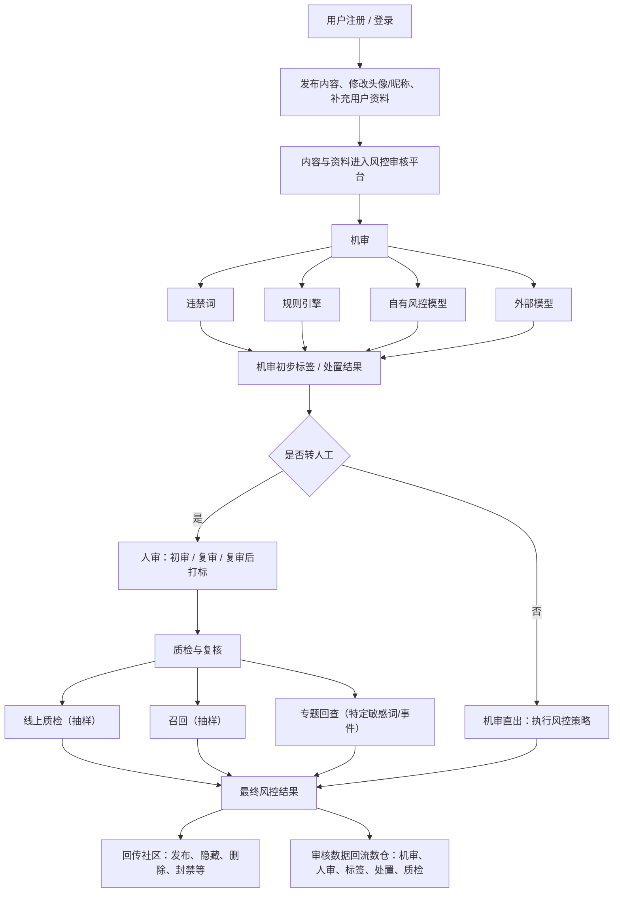
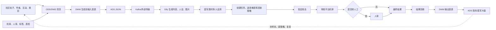

# 小红书风控 AI 蓝军数据资产建设：简历项目拆解与业务全景

## 1. 复盘目标

本文以简历第一个项目“小红书-风控 AI 蓝军数据资产建设”为面试验收标准，解决以下问题：

- 为什么要做这个项目，业务真正痛在哪里。
- 大模型、蓝军系统、审核平台和离线数仓分别做什么。
- 简历中的 DWD 6 张、DWM 2 张、ADS 2 张和 17 个指标怎样解释。
- 哪些工作可以描述为本人负责，哪些只能描述为理解和协同。
- 面试官从简历文字继续追问时，怎样避免表数量、指标数量和业务语义互相矛盾。

来源简历：`D:/Downloads/WeChat/xwechat_files/wxid_9szg2smife0622_5260/msg/file/2026-07/个人简历_数开.pptx` 第 1 页。

## 2. 简历中的项目承诺

简历第一个项目可以拆成四组承诺。

| 承诺类型 | 简历信息 | 面试中必须能够展开的内容 |
| --- | --- | --- |
| 业务问题 | 样本收集依赖人工，约占运营人力 50%；内容生硬、用户无人设、账号不可持续运营 | 黑白样本是什么、为什么同时测试漏过和误伤、为什么需要更真实的人设和内容 |
| 项目方案 | 数据开发＋Dify＋蓝军/审核系统改造 | 四个系统的边界、完整业务流程、自己负责的数据部分 |
| 数据交付 | DWD 6 张、DWM 2 张、ADS 2 张、指标 17 个、蓝军效果大盘 | 每张表叫什么、来源和下游是什么、两张 DWM 为什么不能合并、17 与 ADS 25 字段的差异 |
| 业务结果 | 节省人力、黑白样本增长、攻击成功率变化、机审指标下降到 38% | 指标的分子分母、时间范围、谁提供结果、为什么“机审下降”反而体现样本能力增强 |

## 3. 项目一句话定义

这是一个用历史社区内容和审核数据支撑大模型生成更真实的黑白样本与用户人设，再通过蓝军平台自动投放、回收机审和人审结果，并由离线数仓完成全链路追踪和效果评估的风控攻防项目。

## 4. 黑白样本和“成功”的业务语义

| 样本 | 内容性质 | 正确防守结果 | 错误防守结果 | 蓝军测试价值 |
| --- | --- | --- | --- | --- |
| 黑样本 | 违规、风险或模拟黑产内容 | 拦截 | 漏过 | 找到机审/人审识别薄弱点 |
| 白样本 | 符合平台规则的正常内容 | 放过 | 误伤 | 找到审核过严或规则误判问题 |

面试中不要单独说“成功/失败”，应使用四个明确结果：

- 黑样本拦截：防守正确。
- 黑样本漏过：防守错误、蓝军发现漏洞。
- 白样本放过：防守正确。
- 白样本误伤：防守错误、蓝军发现误判。

PRD 中“黑样本攻击成功率”通常指黑样本被放过；“白样本攻击成功率”公式却统计白样本人审非通过，本质是发现误伤问题的比例。面试时要主动解释这个视角差异。

## 5. 项目参与系统

| 系统 | 输入 | 处理 | 输出 | 当前项目职责边界 |
| --- | --- | --- | --- | --- |
| 社区业务源 | 帖子、作者、互动、类目、媒体 URL | 业务生产和内容沉淀 | 社区动态、类目数据 | 上游数据源 |
| 审核平台 | 用户发布内容 | 违禁词、规则、风控模型、外部模型、机审、人审、质检 | 机审结果、人审结果、标签、处置、质检结果 | 上游和结果回收系统，不描述为本人实现审核策略 |
| 离线数仓 | 社区、审核、蓝军、Dify 工作流数据 | ODS 接入、DWD 标准化、DIM 映射、DWM 宽表、ADS 指标 | 模型输入 JSON、效果明细、指标和大盘数据 | 本人核心负责范围 |
| Dify/大模型 | 数仓提供的优质社区内容、标签和审核上下文 | 分词、高亮、Prompt、文生文、文生图、文生用户、校准出参 | 生成内容、素材、人设、工作流执行记录 | 需要理解和协同，不描述为本人实现工作流/模型 |
| 蓝军系统 | 生成素材、人设、运营账号 | 素材管理、任务配置、样本难度、调度、投放 | 攻击任务、素材使用记录、投放内容 | 下游业务系统，不描述为本人实现前后端或调度引擎 |
| 指标平台/大盘 | ADS 指标和 DWM 明细 | 报表展示、指标管理 | 攻防效果、样本生产和审核质量分析 | 数据集和指标口径属于本人工作，页面研发按实际协作范围表述 |

## 6. 完整业务流程

### 6.1 社区风控审核全流程（补充）

社区侧不仅审核发帖内容，也会审核用户资料、头像和昵称等可变更信息；相关数据进入审核平台后，先经机审形成初步标签和处置建议。机审结果可能直接生效，也可能转入人工复核。人审完成后还会经过线上质检、召回或特定专题回查，最终结果回传社区业务与数仓。

与数仓字段的对应关系：

| 审核环节 | 主要字段 | 数据含义 |
| --- | --- | --- |
| 机审 | `machine_audit_time`、`machine_tag_code`、`machine_tag_result` | 机审时间、标签编码和机审处置结果 |
| 转人工判断 | `is_manual` | 是否由机审流转至人工审核 |
| 人审 | `tag_code`、`tag_result`、`tag_time`、`tag_user_id` | 人审标签、最终处置、审核时间和审核人 |
| 质检 | `audit_result`、`result_result`、`check_content` | 质检前审核结果、质检结果及备注 |

> 机审标签在 DWM 中采用 `left join`，因为它是对全部内容补充的审核信息；人审标签采用 `join`，是为了在需要人审口径的场景中只保留已具备人审标签的记录。审核平台内部的转人工规则、阈值和策略配置不在当前资料范围内。

### 6.2 蓝军项目端到端链路

项目不是单向 ETL，而是“生成闭环＋测评闭环”：

1. 生成闭环解决素材从哪里来、如何更接近真实社区内容。
2. 测评闭环解决素材如何投放、审核是否正确、问题如何量化。

## 7. 简历表数量的推荐口径

### 7.1 DWD 6 张：核心项目交付口径

当前目录共有 8 张 DWD SQL。为了与简历“DWD 6 张”一致，面试中最稳妥的解释是：6 张指直接纳入项目核心交付的明细表。

| 类别 | 表 | 说明 |
| --- | --- | --- |
| 大模型工作流 1 张 | `dwd_ai_workflow_workflow_runs_detail_df` | 记录 Dify 单次运行、输入输出、耗时、Token 和异常 |
| 审核结果 1 张 | `dwd_com_audit_detail_df` | 记录机审、人审、处置、标签和是否转人工 |
| 蓝军业务 4 张 | `dwd_com_audit_ai_blue_user_info_df` | 用户人设 |
|  | `dwd_com_audit_ai_blue_content_df` | 原文、生成内容、多媒体、相似度、黑白属性和难度 |
|  | `dwd_com_audit_ai_blue_resource_df` | 素材及使用状态 |
|  | `dwd_com_audit_ai_blue_user_attack_df` | 素材、用户与攻击任务关系 |

另外两张 DWD 是生成前供数链路的支撑或复用表：

- `dwd_com_trend_detail_df`：历史社区帖子标准化明细。
- `dwd_com_audit_quilty_check_detail_df`：审核质检明细。

除非能够确认这两张也是本人从零开发，否则不要将“目录 8 张”全部算为简历交付。可以说“核心交付 6 张，同时复用了社区动态和质检明细”。

### 7.2 DWM 2 张

| 表 | 位置 | 解决的问题 |
| --- | --- | --- |
| `dwm_com_audit_ai_blue_input_detail_di` | Dify 生成前 | 将帖子、作者、互动、三级类目、机审、人审标签和质检结果合并，形成模型输入 |
| `dwm_com_audit_ai_blue_output_detail_df` | 生成和投放后 | 将素材、生成内容、人设、攻击任务、工作流和审核结果合并，形成效果复盘宽表 |

PRD 历史名 `dwm_com_audit_ai_blue_detail_di` 已确认与当前 `dwm_com_audit_ai_blue_output_detail_df` 是同一张逻辑表，不是输入表的别名。

### 7.3 ADS 2 张

| 表 | 作用 | 注意事项 |
| --- | --- | --- |
| `ads_operation_com_ai_blue_2kafka` | 把生成前宽表封装成 Dify/Kafka 使用的 JSON | 当前资料没有 INSERT，实际 Kafka Producer 或调度不在 SQL 中 |
| `ads_operation_com_ovewview_target` | 汇总素材、攻击、复投、黑白样本、机审和人审结果 | `ovewview` 是原始表名拼写；当前资料同样没有 INSERT |

### 7.4 指标 17 个与 ADS 25 个字段

- 简历中的 17 个应解释为 PRD 定义的 17 类业务指标/看板模块。
- 当前 ADS DDL 有 25 个物理字段，因为一个业务指标可能拆成黑样本、白样本、机审、人审、成功、失败等多个字段。
- PRD 的 17 类需求并非全部都能在现有这一张 ADS SQL 中找到直接计算字段，例如防御质量分、仿真覆盖维度、标签覆盖范围和人设排行榜仍需要其他逻辑或数据集。
- 因此不能回答“17 就是 SELECT 中 17 个字段”，也不能说 ADS 25 字段代表实现了 25 类业务指标。

## 8. 本人工作应怎样表述

### 8.1 可以明确表述为本人负责

- 与 mentor、AI 产品、策略和后端确认数据链路、字段、枚举、JSON 结构和指标口径。
- 申请并接入社区、审核、蓝军业务和工作流运行数据。
- 建设核心 DWD 明细，完成类型统一、枚举映射、逻辑删除过滤和时间标准化。
- 建设生成前 DWM 输入宽表，向 Dify 提供优质社区内容及审核上下文。
- 建设生成后 DWM 输出宽表，关联素材、内容、人设、任务、工作流和审核结果。
- 建设 ADS JSON 查询和攻防指标数据集，支撑指标平台和蓝军效果大盘。
- 对黑白样本、复投、机审、人审、相似度和难度等口径进行维护和复盘。

### 8.2 需要使用“协同/了解/支撑”的表述

- Dify 工作流编排、Prompt 工程、模型选择、Stable Diffusion 和算法效果。
- Kafka Producer、实时 Agent 和外部传输程序。
- 蓝军平台前后端、任务调度和账号运营逻辑。
- 审核平台规则、模型和人审策略的研发。
- 风控策略最终调整和业务收益归因。

推荐表达：

> 我负责离线数据资产和指标链路，并与 Dify、蓝军平台、审核平台的负责人对齐接口。Dify 内部如何分词和生成我了解业务流程，但不是我开发；我负责保证它拿到的数据完整、可解释，并把生成、投放和审核结果重新关联回来。

## 9. 简历文字中的面试风险

### 9.1 “离线大模型客服自动化资产建设”

该项目是风控 AI 蓝军，不是客服自动化。“客服”很像其他项目复制残留。面试官可能直接追问客服场景，建议简历后续改为：

> 完成风控 AI 蓝军离线数据资产建设。

### 9.2 “DWD 6 张”与“明细及宽表 4 张”

两个数字容易被理解为互相矛盾。推荐解释或修改为：

> 完成 4 张蓝军业务 DWD 明细表，并关联审核明细与大模型工作流明细，形成 2 张 DWM 宽表；项目核心 DWD 共 6 张。

### 9.3 “周降低 3 人/天”

单位表达不清。若原意是每周节省 3 个工作日的人力，应写“每周节省约 3 人天”；若是每日减少 3 人投入，则需给出统计周期和计算依据。

### 9.4 “蓝军机审成功率降低至 38%”

“机审成功率”从谁的视角定义不清。推荐改成可验证的结果描述：

> 黑样本机审直接拦截率由 70%+ 降至 38%，说明新样本更能暴露机审薄弱点。

如果实际指标不是“黑样本机审拦截率”，必须按业务最终口径调整，不能仅凭 PRD 文案推断。

### 9.5 量化结果的归因

白样本提高 50%、黑样本提高 20%、攻击成功率变化等是项目整体结果。除非有个人实验或归因数据，不要说“我通过某条 SQL 直接把成功率提高了”。应说：

> 我负责的数据链路支撑了样本生成、投放效果评估和策略复盘，项目整体达到这些业务结果。

## 10. 项目负责人视角的验收标准

如果把整个项目交付看成一个负责人验收清单，应满足：

1. 业务能解释黑白样本、首投/复投、机审/人审和成功/失败语义。
2. 数据能从社区内容追到 Dify 输入，从生成内容追到素材、人设、攻击任务和审核结果。
3. 每张 DWD 有清晰粒度、主键、枚举和删除口径。
4. 两张 DWM 的粒度、主表和 JOIN 保留策略清楚。
5. ADS 指标有分子、分母、时间窗口和黑白样本方向。
6. Dify、Kafka、审核平台和蓝军平台的责任边界清楚。
7. 简历中的表数量、指标数量和业务收益能够一致解释。
