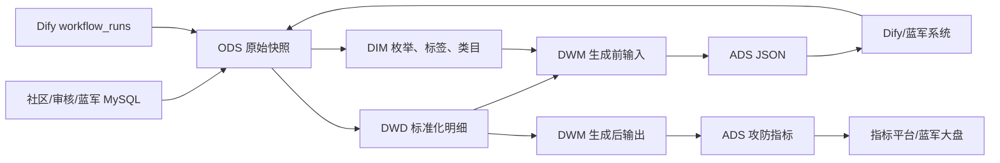

# AI 蓝军逐层表清单与完整血缘

## 1. 分层总览

当前整理目录包含 24 份表说明：ODS 8、DWD 8、DIM 4、DWM 2、ADS 2。除此之外，SQL 还引用 2 张未在目录中提供 DDL 的上游 ODS 表。



## 2. ODS 层：源系统原始快照

ODS 的职责是尽量保留源系统字段和状态，不承担复杂业务计算。

### 2.1 当前目录中的 8 张 ODS

| 表 | 字段数 | 业务粒度 | 关键字段 | 核心内容 | 下游 |
| --- | ---: | --- | --- | --- | --- |
| `ods_community_community_trend_df` | 54 | 一条社区动态/帖子 | `id` | 标题、正文、作者、互动、媒体、精选、三级类目、URL、发布时间 | `dwd_com_trend_detail_df` |
| `ods_community_community_audit_result_df` | 19 | 一条审核记录 | `id`、`biz_id`、`event_code` | 人审标签和处置、机审标签和处置、是否转人工、审核人和时间 | `dwd_com_audit_detail_df` |
| `ods_community_community_quilty_check_df` | 10 | 一条质检记录 | `id`、`audit_id`、`biz_id` | 审核结果、质检备注、质检结果 | `dwd_com_audit_quilty_check_detail_df` |
| `ods_community_audit_tag_df` | 5 | 一个审核标签 | `tag_code` | 标签名称、负责人、创建和更新时间 | `dim_com_audit_tag_df` |
| `ods_community_ai_blue_user_info_df` | 12 | 一个蓝军用户人设 | `user_id` | 昵称、签名、头像、人设、生成状态、工作流请求 ID | `dwd_com_audit_ai_blue_user_info_df` |
| `ods_community_ai_blue_content_df` | 23 | 一条 AI 蓝军生成内容 | `ai_task_id`、`trend_id`、`resource_id` | 原文、改写、多媒体、相似度、黑白属性、难度、用户、请求 ID | `dwd_com_audit_ai_blue_content_df` |
| `ods_community_ai_blue_resource_df` | 10 | 一条蓝军素材 | `id` | 素材组、使用时间、是否复用、创建修改信息、删除状态 | `dwd_com_audit_ai_blue_resource_df` |
| `ods_community_ai_blue_user_attack_df` | 10 | 一条用户-素材-任务关系 | `id`、`attack_task_id`、`resource_id` | 攻击用户、任务、素材、操作人、删除状态 | `dwd_com_audit_ai_blue_user_attack_df` |

### 2.2 SQL 引用但目录未提供 DDL 的 ODS

| 表 | 被谁使用 | 已知字段/用途 |
| --- | --- | --- |
| `ods_ai_workflow_workflow_runs_df` | `dwd_ai_workflow_workflow_runs_detail_df` | Dify 工作流单次运行；包含 ID、应用、工作流、输入输出、状态、耗时、Token 和异常 |
| `ods_community_community_category_df` | `dim_com_trend_category_df` | 类目编码、三级类目编码和名称、创建修改信息 |

需要区分：已确认不需要的是 `ods_ai_workflow_workflow_df`，当前实际依赖的是带 `runs` 的运行明细表。

## 3. DWD 层：统一粒度、类型和枚举

### 3.1 核心项目交付 6 张

| 表 | 字段数 | 来源 | 关键加工 | 关键键 | 下游 |
| --- | ---: | --- | --- | --- | --- |
| `dwd_ai_workflow_workflow_runs_detail_df` | 22 | `ods_ai_workflow_workflow_runs_df` | 字段重命名；时间加 28800 秒；从 `input.$.id` 提取 `biz_id` | `workflow_runs_id`、`biz_id` | DWM 输出 |
| `dwd_com_audit_detail_df` | 22 | `ods_community_community_audit_result_df` | event、tag_result、content_type、machine_result 枚举映射；ID 类型统一 | `audit_id`、`biz_id`、`event_code` | DWM 输入、DWM 输出 |
| `dwd_com_audit_ai_blue_user_info_df` | 12 | `ods_community_ai_blue_user_info_df` | `user_id` 转字符串；人设生成状态映射为名称 | `ai_blue_user_id`、`user_style_request_id` | DWM 输出 |
| `dwd_com_audit_ai_blue_content_df` | 24 | `ods_community_ai_blue_content_df` | 内容类型和样本属性映射；原文/生成内容字段标准化 | `ai_blue_content_task_id`、`trend_id`、`resource_id`、`ai_blue_user_id`、`ai_blue_content_request_id` | DWM 输出 |
| `dwd_com_audit_ai_blue_resource_df` | 9 | `ods_community_ai_blue_resource_df` | ID 转字符串；过滤 `is_del=0` | `resource_id` | DWM 输出主表 |
| `dwd_com_audit_ai_blue_user_attack_df` | 8 | `ods_community_ai_blue_user_attack_df` | 过滤 `is_del=0`；保留用户、素材、攻击任务关系 | `user_id`、`resource_id`、`attack_task_id` | DWM 输出 |

### 3.2 生成前供数支撑/复用 DWD 2 张

| 表 | 字段数 | 来源 | 关键加工 | 关键键 | 下游 |
| --- | ---: | --- | --- | --- | --- |
| `dwd_com_trend_detail_df` | 56 | `ods_community_community_trend_df` | 内容、互动和类目字段标准化；精选/展示/内容类型映射；毫秒时间戳转换；过滤 `is_del=0` | `trend_id` | DWM 输入 |
| `dwd_com_audit_quilty_check_detail_df` | 12 | `ods_community_community_quilty_check_df` | 审核和质检结果映射 | `check_id`、`audit_id`、`biz_id` | DWM 输入 |

质检表当前整理文件名为 `dwd_com_audit_quality_check_detail_df.sql`，但截图、DDL、INSERT 和下游 JOIN 的真实 SQL 对象名都使用 `quilty`。

## 4. DIM 层：稳定维度和枚举翻译

| 表 | 字段数 | 来源/维护方式 | 关联条件 | 使用位置 | 主链路状态 |
| --- | ---: | --- | --- | --- | --- |
| `dim_code_desc` | 手工映射 | 人工维护 | `table_name + content_type/fields_name + code` | 多张 DWD 把 code 映射为中文 name | 使用中 |
| `dim_com_audit_tag_df` | 5 | `ods_community_audit_tag_df` | `tag_code` | DWM 输入拆分机审/人审标签后取标签名 | 使用中 |
| `dim_com_trend_category_df` | 12 | `ods_community_community_category_df` | `level3_category_code` | DWM 输入补充一级、二级、三级类目名称 | 使用中 |
| `dim_com_ecology_tag_df` | 4 | `ods_community_ecology_tag_df` | `tag_code` | 当前 SQL 主链路没有引用 | 已确认不属于当前蓝军主链路，仅保留历史截图 |

`dim_code_desc` 不是单一业务维度，而是通用枚举翻译表。当前 SQL 使用的映射包括：

- 社区内容类型、展示状态、精选类型。
- 审核事件、人工处置、机审处置、内容类型。
- 蓝军内容类型、黑白样本属性。
- 蓝军人设生成状态。
- 审核和质检结果。

## 5. DWM 输入表：生成前供数血缘

### 5.1 表定位

`dwm_com_audit_ai_blue_input_detail_di` 共 20 个业务字段，目标粒度是“当日发布的一条社区内容及其审核上下文”。

主表是 `dwd_com_trend_detail_df t0`，最终过滤：

```sql
WHERE t0.pt='${bizdate}'
  AND SUBSTR(t0.publish_time,1,10)='${bizdate}'
```

因此它不是全历史帖子宽表，而是处理分区内、发布日期等于业务日期的内容。

### 5.2 逐个 JOIN

| 顺序 | 关联表 | JOIN 类型 | 关联条件 | 补充字段 | 对结果行的影响 |
| ---: | --- | --- | --- | --- | --- |
| 1 | `dim_com_trend_category_df t1` | LEFT JOIN | `t0.level3_category_code=t1.level3_category_code` | 一级、二级、三级类目名称 | 类目未匹配仍保留帖子，类目名称为空 |
| 2 | `dwd_com_audit_detail_df t2` | LEFT JOIN | `t0.trend_id=t2.biz_id` | 机审结果、人审处置结果 | 无审核记录仍保留；同一内容多审核记录会放大行数 |
| 3 | `dwd_com_audit_quilty_check_detail_df t3` | LEFT JOIN | `t0.level3_category_code=t3.biz_id` | 质检结果名称 | 按截图保留；业务上使用类目编码关联质检业务 ID，需特别确认 |
| 4 | 机审标签聚合 `t4` | LEFT JOIN | `t0.trend_id=t4.biz_id` | `machine_tag_name_list` | 无机审标签仍保留 |
| 5 | 人审标签聚合 `t5` | INNER JOIN | `t0.trend_id=t5.biz_id` | `tag_name_list` | 没有可映射人审标签的帖子被过滤 |

### 5.3 标签字段血缘

机审标签：

```text
dwd_com_audit_detail_df.machine_tag_code
→ SPLIT(',')
→ EXPLODE 为 machine_tag_code2
→ dim_com_audit_tag_df.tag_code
→ COLLECT_LIST(tag_name)
→ machine_tag_name_list
```

人审标签：

```text
dwd_com_audit_detail_df.tag_code
→ SPLIT(',')
→ EXPLODE 为 tag_code2
→ dim_com_audit_tag_df.tag_code
→ COLLECT_LIST(tag_name)
→ tag_name_list
```

由于人审标签使用内连接，它同时承担数据筛选作用。面试中可以解释为“只把有人审标签、可用于风险语义学习的内容送入模型”，但该解释需要与产品最终口径一致。

### 5.4 下游 JSON

`ads_operation_com_ai_blue_2kafka` 从该表读取：

- 外层：`trendId`、`url`、`data`。
- `data`：标题、正文、作者、粉丝、点赞、回复、分享、三级类目、精选状态、机审结果、人审结果、标签和质检结果。

当前 SQL 只生成 JSON 字符串，没有提供 INSERT，也没有 Kafka Producer 代码。

## 6. DWM 输出表：生成后全链路血缘

### 6.1 表定位

`dwm_com_audit_ai_blue_output_detail_df` 以蓝军素材 `resource` 为主表，目标是把“素材—内容—人设—攻击—Dify 运行—审核结果”拼到同一行。

PRD 历史名 `dwm_com_audit_ai_blue_detail_di` 已确认是这张表的逻辑旧名。

### 6.2 逐个 JOIN

| 顺序 | 别名 | 表 | JOIN 类型 | 条件 | 业务含义 |
| ---: | --- | --- | --- | --- | --- |
| 主表 | `t0` | `dwd_com_audit_ai_blue_resource_df` | FROM | `pt='${bizdate}'` | 每条有效素材是宽表起点 |
| 1 | `t1` | `dwd_com_audit_ai_blue_content_df` | LEFT JOIN | `t0.resource_id=t1.resource_id` | 补原文、生成内容、多媒体、相似度、黑白属性、难度和请求 ID |
| 2 | `t2` | `dwd_com_audit_ai_blue_user_info_df` | LEFT JOIN | `t1.ai_blue_user_id=t2.ai_blue_user_id` | 补用户人设、昵称、签名、头像和人设请求 ID |
| 3 | `t3` | `dwd_com_audit_ai_blue_user_attack_df` | LEFT JOIN | `t0.resource_id=t3.resource_id` | 补攻击任务及操作时间 |
| 4 | `t4` | `dwd_ai_workflow_workflow_runs_detail_df` | LEFT JOIN | `t1.ai_blue_content_request_id=t4.workflow_runs_id` | 补 Dify 输入输出、耗时和 Token |
| 5 | `t5` | `dwd_com_audit_detail_df` | LEFT JOIN | `t1.trend_id=t5.biz_id` | 补机审、人审和最终处置结果 |

### 6.3 宽表包含的主题

| 主题 | 代表字段 |
| --- | --- |
| 素材 | `resource_id`、素材组、`use_time`、`is_used`、创建修改信息 |
| 生成内容 | 原文/新文本、原图/新图、原视频/新视频、相似度、内容类型、类目 |
| 样本 | `ai_blue_sample_code`、样本名称、难度等级 |
| 人设 | `ai_blue_user_id`、昵称、头像、签名、风格、生成状态、请求 ID |
| 攻击 | 实际攻击用户、任务 ID、任务名称、创建修改信息 |
| Dify | 运行 ID、应用 ID、工作流 ID、inputs、outputs、耗时、Token |
| 审核 | 审核 ID、事件、人工处置、审核人、是否转人工、机审时间和结果 |

### 6.4 实际粒度和数据膨胀风险

理论上希望一行代表“一条素材的一次生成和投放结果”，但 SQL 没有在 JOIN 前去重：

- 一个 `resource_id` 可能对应多条生成内容。
- 一个 `resource_id` 可能参加多个攻击任务。
- 一个 `trend_id` 可能有多条审核记录。
- 多个一对多关系同时 JOIN 时可能形成乘积。

例如一条素材有 2 条内容、3 个攻击任务，其中每条内容又有 2 条审核记录，理论上可能产生 `2×3×2=12` 行。下游直接 `COUNT(resource_id)` 或 `COUNT(attack_task_id)` 会被放大。

生产设计通常需要先明确目标粒度，再按业务选择：

- 取最新一条：`ROW_NUMBER() OVER(PARTITION BY key ORDER BY modify_time DESC)=1`。
- 任务级保留：将宽表粒度定义为 `resource_id + attack_task_id`。
- 审核级保留：再增加 `audit_id`。
- 指标端使用 `COUNT(DISTINCT ...)`。

当前截图 SQL没有这些处理，复盘时应将其作为数据质量风险，而不是声称已经解决。

## 7. ADS 层血缘

### 7.1 `ads_operation_com_ai_blue_2kafka`

```text
dwm_com_audit_ai_blue_input_detail_di
→ 内层 data_json
→ 外层 trendId/url/data
→ ai_blue_json
→ 外部任务/Kafka/Dify
```

该表服务生成闭环，不服务最终效果统计。

### 7.2 `ads_operation_com_ovewview_target`

```text
dwm_com_audit_ai_blue_output_detail_df 当日分区
+ 同表按 resource_id 聚合近 7 日 attack_task_cnt_7d
→ 按素材创建日期、内容类型聚合
→ 素材/攻击/用户/复投/机审/人审/相似度/难度指标
```

其分组粒度为：

```text
SUBSTR(ai_blue_resource_create_time,1,10) + ai_blue_content_type_name
```

## 8. 核心 ID 的字段级血缘

### 8.1 `trend_id`：内容与审核的桥

```text
ods_community_community_trend_df.id
→ dwd_com_trend_detail_df.trend_id
→ DWM 输入主键

ods_community_ai_blue_content_df.trend_id
→ dwd_com_audit_ai_blue_content_df.trend_id
→ dwd_com_audit_detail_df.biz_id
→ DWM 输出审核关联
```

### 8.2 `resource_id`：输出链路核心桥

```text
ods_community_ai_blue_resource_df.id
→ dwd_com_audit_ai_blue_resource_df.resource_id
→ DWM 输出主表

ods_community_ai_blue_content_df.resource_id
→ dwd_com_audit_ai_blue_content_df.resource_id
→ 关联素材与生成内容

ods_community_ai_blue_user_attack_df.resource_id
→ dwd_com_audit_ai_blue_user_attack_df.resource_id
→ 关联素材与攻击任务
```

### 8.3 用户 ID：AI 人设用户和实际攻击账号

```text
content.user_id
→ dwd_content.ai_blue_user_id
→ user_info.ai_blue_user_id
→ 找到 AI 用户人设

user_attack.user_id
→ dwd_user_attack.user_id
→ 实际执行攻击的运营账号
```

两种用户 ID 语义不同，不能因为都来自 `user_id` 就混为一个字段。

### 8.4 工作流请求 ID

```text
content.request_id
→ dwd_content.ai_blue_content_request_id
→ workflow_runs.workflow_runs_id
→ 找到内容生成工作流

user_info.user_style_request_id
→ dwd_user_info.user_style_request_id
→ 人设生成请求
```

当前 DWM 输出只用内容请求 ID 关联 workflow_runs；人设请求 ID 被保留并在 ADS 中计数，但没有在 DWM 中再次关联工作流明细。

### 8.5 攻击和审核 ID

| ID | 传递路径 | 用途 |
| --- | --- | --- |
| `attack_task_id` | ODS attack → DWD attack → DWM 输出 → ADS | 攻击次数和任务追踪 |
| `audit_id` | ODS audit → DWD audit → DWM 输出 | 审核记录追踪 |
| `biz_id` | ODS audit/workflow → DWD | 与内容或业务对象关联 |
| `pt` | 每层 `${bizdate}` 分区 | 控制日批装载和分区裁剪 |

## 9. 全链路表级血缘清单

| 上游 | 下游 | 关联/装载方式 |
| --- | --- | --- |
| `ods_community_community_trend_df` | `dwd_com_trend_detail_df` | 日分区清洗，过滤删除内容 |
| `ods_community_community_audit_result_df` | `dwd_com_audit_detail_df` | 日分区清洗＋通用枚举映射 |
| `ods_community_community_quilty_check_df` | `dwd_com_audit_quilty_check_detail_df` | 日分区清洗＋质检结果映射 |
| `ods_community_audit_tag_df` | `dim_com_audit_tag_df` | 标签维度日分区覆盖 |
| `ods_community_community_category_df` | `dim_com_trend_category_df` | 三级类目维度日分区覆盖 |
| `ods_community_ai_blue_user_info_df` | `dwd_com_audit_ai_blue_user_info_df` | 人设状态映射 |
| `ods_community_ai_blue_content_df` | `dwd_com_audit_ai_blue_content_df` | 内容/样本枚举映射 |
| `ods_community_ai_blue_resource_df` | `dwd_com_audit_ai_blue_resource_df` | 过滤逻辑删除 |
| `ods_community_ai_blue_user_attack_df` | `dwd_com_audit_ai_blue_user_attack_df` | 过滤逻辑删除 |
| `ods_ai_workflow_workflow_runs_df` | `dwd_ai_workflow_workflow_runs_detail_df` | 时间转换、JSON 业务 ID 提取 |
| 趋势 DWD＋审核 DWD＋质检 DWD＋类目/标签 DIM | `dwm_com_audit_ai_blue_input_detail_di` | 以 `trend_id` 为核心拼接 |
| DWM 输入 | `ads_operation_com_ai_blue_2kafka` | JSON 序列化 |
| 资源 DWD＋内容 DWD＋人设 DWD＋攻击 DWD＋workflow DWD＋审核 DWD | `dwm_com_audit_ai_blue_output_detail_df` | 以 `resource_id` 为主线拼接 |
| DWM 输出 | `ads_operation_com_ovewview_target` | 当日＋近 7 日聚合 |

## 10. 面试中必须主动说明的血缘边界

1. SQL 能证明 JSON 如何生成，但不能证明 Kafka Producer 如何实现。
2. SQL 能记录 Dify 的 inputs/outputs/耗时，但不能证明 Prompt 和模型节点由本人开发。
3. SQL 能回收审核结果，但不能证明机审规则、人审流程由本人开发。
4. DWM 输出是左连接保留素材，不代表所有素材都有内容、任务、工作流和审核结果。
5. 目录中的历史生态标签维表不属于当前蓝军主链路。
6. 表级血缘清楚不等于指标天然准确；必须继续检查粒度、重复和 JOIN 放大。

